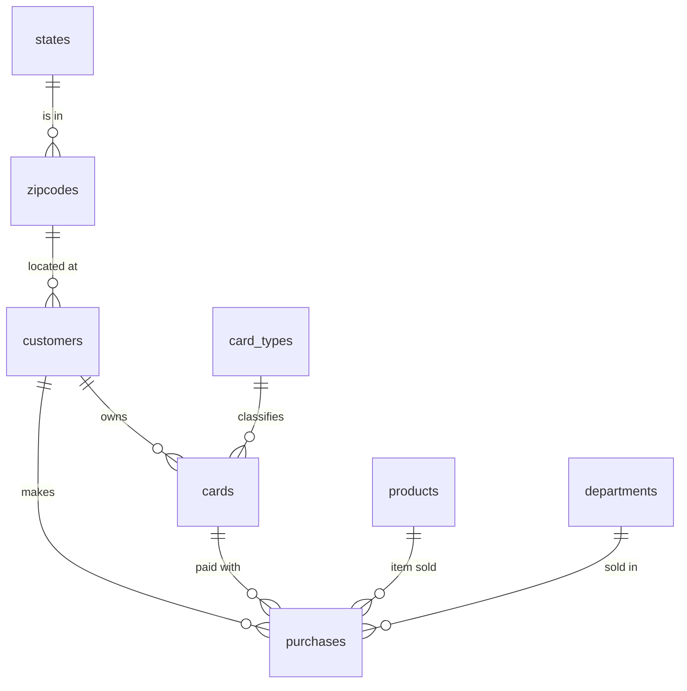

# 04 — Model the data: SQLite

> **Fixed question:** How does the `store` dataset *want* to look in this engine?
>
> **Student artifact:** Your schema for the `people_products` data, with the
> evidence behind it (see [Part B](#part-b--your-turn-people_products--orders))

For a relational engine, "how does the data want to look" means
**normalization**: store each fact once, in the table its key depends on.

This section has two parts:

- **Part A** is a worked example. It takes the flat classroom CSV to the
  8-table `store` schema, one decision at a time, and shows every answer.
  Pause where it asks you to predict; you'll get more out of it.
- **Part B** is your turn. You apply the same method to a richer, messier
  dataset, and nobody shows you the answers.

---

## Part A — Walkthrough: `store_flat.csv` → `store`

### A1. Look at the raw data

```bash
head -3 ../../../datasets/store/classroom/store_flat.csv
```

```
id,first_name,last_name,email,cc_type,cc_number,purchase_dept,purchase_amount,address,zipcode,state,prod_name,purchase_data
1,Leighton,Pavelka,lpavelka0@time.com,solo,633492725057411162,Garden,89.99,63 Columbus Parkway,80126,CO,Electric Pressure Cooker,3/9/2026
```

1,000 rows, 13 columns, one row per purchase. `purchase_data` is a typo in
the source; it holds a date in `M/D/YYYY` form.

> **Predict:** each row mixes facts about several different *things*. How
> many things, and which columns describe each one?

<details>
<summary>Answer</summary>

| Column(s)                                                | Really describes a…                  |
| -------------------------------------------------------- | ------------------------------------ |
| `first_name`, `last_name`, `email`, `address`, `zipcode` | customer                             |
| `state`                                                  | location (the state a zipcode is in) |
| `cc_type`, `cc_number`                                   | payment card                         |
| `prod_name`, `purchase_amount`                           | product in a catalog                 |
| `purchase_dept`, `purchase_amount`, `purchase_data`      | a single purchase event              |

`purchase_amount` shows up twice on purpose: it's the product's price, *and*
it's what this purchase was charged. Section A5 comes back to that.

`purchase_dept` is listed under the purchase, not the product. That's not
obvious, and you can't know it from reading column names. Section A3 shows
how the data proves it.

</details>

### A2. Why the flat table is a problem

Storing it as delivered repeats the same fact on many rows, which causes the
three classic anomalies (see the [glossary](../../00_foundations/glossary.md#anomalies-what-normalization-prevents)):

- **Update anomaly:** a product's price is written on every row that sold it.
  Miss one copy during a price change, and the data contradicts itself.
- **Insertion anomaly:** you can't record a new product until someone buys it.
- **Deletion anomaly:** delete a customer's only purchase, and the customer,
  their address, and their card disappear with it.

### A3. Test each belief against the data

The grouping in A1 is a set of **beliefs**, like "a zipcode determines its
state." A belief becomes a design decision only after the data backs it up.

The test is always the same shape. **"X determines Y" means no value of X
ever appears with two different values of Y**, so ask SQL for a
counterexample:

```sql
SELECT zipcode, count(DISTINCT state) AS distinct_states
FROM staging_raw
GROUP BY zipcode
HAVING distinct_states > 1;   -- any row here breaks "zipcode -> state"
```

No rows means no counterexample, so the belief holds *in this data*.

All nine checks are in
[../05_load/data_quality.sql](../05_load/data_quality.sql), with their
results. To run them, load the CSV into staging (steps A and B of
[load_classroom.sql](../05_load/load_classroom.sql)) and `.read` the file.

| Question                                      | Answer in this data | Design consequence                              |
| --------------------------------------------- | ------------------- | ----------------------------------------------- |
| Is `id` unique?                               | yes (1000/1000)     | usable as a primary key                         |
| Does an `email` ever have two names?          | no                  | `email` identifies a person → `customers`       |
| Does a `zipcode` ever map to two `state`s?    | no                  | **`zipcode → state`** → a `zipcodes` table      |
| Does a `cc_number` ever have two `cc_type`s?  | no                  | the card type lives on the card                 |
| Is a `cc_number` shared by two people?        | no                  | one card → one customer (1:N)                   |
| Does a `prod_name` ever have two prices?      | no                  | **`prod_name → price`** → `products.unit_price` |
| Does a `prod_name` appear in two departments? | *predict first…*    |                                                 |
| Do all dates have the same format?            | yes, all `M/D/YYYY` | one parsing rule converts them all              |
| Are any required columns blank?               | no                  | `NOT NULL` constraints won't reject anything    |

> **Predict:** does a product always belong to one department?

<details>
<summary>Answer</summary>

**No. 181 of the 775 products appear in more than one department.** For
example, the "Adjustable Height Standing Desk Converter" was sold under
Toys, Home, *and* Automotive.

Instinct says "a product belongs to a department," but the data says the same
product is sold under different departments on different purchases. So
`department` is a fact about the **purchase**, not the product, and it goes on
`purchases`.

**You can only make that call by looking.** This is the main lesson of the
whole section.

</details>

### A4. The schema

```
states ─< zipcodes ─< customers ─< cards ─< purchases >─ products
                                    │                 │
                          card_types┘       departments┘
```



Each table traces back to a check in A3:

| Table                                 | Why it exists                                                                                                   |
| ------------------------------------- | --------------------------------------------------------------------------------------------------------------- |
| `states`, `card_types`, `departments` | Small sets of allowed values. A foreign key to them works like a `CHECK (x IN (...))` you can query and extend. |
| `zipcodes`                            | `zipcode → state`. Without it, `state` would ride along on every customer and could disagree with itself.       |
| `customers`                           | `email` identifies a person.                                                                                    |
| `cards`                               | `cc_number → cc_type`, and one customer can have many cards.                                                    |
| `products`                            | `prod_name → price`. No department, because of the A3 surprise.                                                 |
| `purchases`                           | The fact table: one row per event, with every descriptive column replaced by a foreign key.                     |

The full DDL, with the reasoning in comments, is in [schema.sql](schema.sql).

### A5. One column that looks redundant but isn't

`purchases.amount` equals `products.unit_price` on every row in this data. So
why store it twice?

<details>
<summary>Answer</summary>

Because they're different facts that happen to be equal today.
`products.unit_price` is what the product costs **now**. `purchases.amount` is
what this customer **was charged** on that day. When the price changes,
yesterday's receipts must not change with it.

That's deliberate, correct duplication. Normalization removes repeated
*facts*, not repeated *values*.

</details>

### A6. Load it

Don't insert straight from a CSV into tables with constraints. The loader,
[load_classroom.sql](../05_load/load_classroom.sql), does it in stages, and
each step is commented:

| Step | What it does                                                                                                                                                                |
| ---- | --------------------------------------------------------------------------------------------------------------------------------------------------------------------------- |
| A–B  | Land the raw file in `staging_raw`: every column `TEXT`, no constraints, so it accepts anything.                                                                            |
| C    | Fill the parent tables first (`states`, `card_types`, `departments`, `zipcodes`) with `INSERT … SELECT DISTINCT`.                                                           |
| D–E  | `customers`, then `cards`.                                                                                                                                                  |
| F    | `products`: collapse 1,000 rows to one per name with `GROUP BY`.                                                                                                            |
| G    | `purchases`: join staging back to the parents on their natural keys (`email`, `cc_number`, `prod_name`) to look up the new ids, and convert `M/D/YYYY` to ISO `YYYY-MM-DD`. |
| H    | Drop staging, so nobody queries the un-normalized copy by accident.                                                                                                         |

Why the staging table is all `TEXT`: **33 zipcodes start with a 0.** Let a
tool guess the type, and `01114` becomes the number `1114`. The sqlite3
CLI's `.import` does exactly that if it creates the table for you.

Build it and check the result:

```bash
cd ../05_load
sqlite3 store.db ".read rebuild.sql"
```

| Table         | Rows  |
| ------------- | ----- |
| `states`      | 47    |
| `zipcodes`    | 774   |
| `card_types`  | 13    |
| `departments` | 22    |
| `customers`   | 1,000 |
| `cards`       | 1,000 |
| `products`    | 775   |
| `purchases`   | 1,000 |

1,000 flat rows became 4,632 rows in 8 tables, and every fact is stored once.

### A7. SQLite-specific design decisions

These are the choices that will look different in other engines. Each one is a
row in the [concept map](../../../concept_map.md).

| Decision                   | What we did                                                                                                           | Why (in SQLite)                                                                                                                                                             |
| -------------------------- | --------------------------------------------------------------------------------------------------------------------- | --------------------------------------------------------------------------------------------------------------------------------------------------------------------------- |
| **Types**                  | Declared `INTEGER`, `TEXT`, `NUMERIC`                                                                                 | SQLite uses *type affinity*: a declared type is a preference, not a rule. We declare types anyway because they document intent. `STRICT` tables (3.37+) would enforce them. |
| **Dates**                  | `TEXT` in ISO `YYYY-MM-DD`, guarded by `CHECK (purchase_date GLOB '????-??-??')`                                      | SQLite has no `DATE` type. ISO text sorts chronologically and works with `date()`, `strftime()`, and `julianday()`.                                                         |
| **Money**                  | `NUMERIC`                                                                                                             | No exact decimal type. `NUMERIC` affinity stores `89.99` as a REAL. Good enough here; PostgreSQL will be stricter.                                                          |
| **Surrogate keys**         | `INTEGER PRIMARY KEY` on `customers`, `cards`, `products`, `purchases`                                                | In SQLite this *is* the internal `rowid`, so primary-key lookups are as fast as they get.                                                                                   |
| **Natural keys**           | `states`, `card_types`, `departments` keyed by the value itself; `email`, `card_number`, `product_name` kept `UNIQUE` | Small lookup tables don't need a surrogate.                                                                                                                                 |
| **Foreign keys**           | Declared with `ON DELETE CASCADE` (customer → cards) and `RESTRICT` (into `purchases`)                                | **Not enforced unless `PRAGMA foreign_keys = ON`** on each connection.                                                                                                      |
| **Foreign-key indexes**    | Created explicitly at the end of the schema                                                                           | **SQLite doesn't index foreign keys automatically.** Without these, Q04 and Q08 scan the whole table (you'll measure it in [§7](../07_explain/)).                           |
| **Deliberate duplication** | `purchases.amount` stored even though it equals `products.unit_price` today                                           | It's a point-in-time snapshot of what was charged, and it must not change when the catalog price does.                                                                      |

---

## Part B — Your turn: `people_products` + orders

Now do the same thing with data that's closer to a real store:

| File                                                                           | Rows   | What it is                            |
| ------------------------------------------------------------------------------ | ------ | ------------------------------------- |
| [people.csv](../../../datasets/people_products/people.csv)                     | 3,000  | Customers, their card, their login    |
| [products.csv](../../../datasets/people_products/products.csv)                 | 5,000  | Catalog with categories and inventory |
| [us_zips.csv](../../../datasets/people_products/us_zips.csv)                   | 40,932 | Zip → city, state, county, lat/lon    |
| [orders.csv](../../../datasets/people_products/generated/classroom/orders.csv)           | 5,000  | One row per order                     |
| [order_items.csv](../../../datasets/people_products/generated/classroom/order_items.csv) | 9,555  | One row per line in an order          |

This data doesn't arrive as one flat file. It comes as several files that
already overlap, disagree, and repeat themselves in places. That's what real
data looks like.

### B1. Sort the columns

Before running anything, list every column across the five files and group
them by the *thing* each one describes, as in A1. Keep this list; you'll
revise it.

### B2. Run the checks

[your_turn_checks.sql](your_turn_checks.sql) loads all five files into
`TEXT` staging tables and runs 22 checks. The queries are written for you.
Finishing each one is your job:

1. **Predict** the result before you run it.
2. **Run it**, and record what it returned.
3. **Decide** what it means for your design.

```bash
cd units/01_sqlite/04_model
sqlite3 your_turn.db ".read your_turn_checks.sql"
```

If a result surprises you, go back and revise B1. Some of them should.

### B3. Design the schema

Using only your evidence from B2, write `my_schema.sql`: tables, keys,
foreign keys, and `NOT NULL`/`UNIQUE`/`CHECK` constraints. Then load it
(adapt the steps in A6) and prove it worked:

```sql
PRAGMA foreign_keys = ON;
PRAGMA foreign_key_check;   -- must print nothing
```

There's no single right answer. Two good schemas can disagree, as long as
each one can point to the check that justifies it.

## Your artifact

1. Your column grouping from B1, and how it changed after B2.
2. `your_turn_checks.sql` with every check completed. **The surprises are
   worth more than the confirmations.**
3. `my_schema.sql`, the loader you adapted, and the row count of every table.
4. A short rationale for three decisions where you had a real choice. For
   each one, say what you chose, what you rejected, and which check settled
   it.
